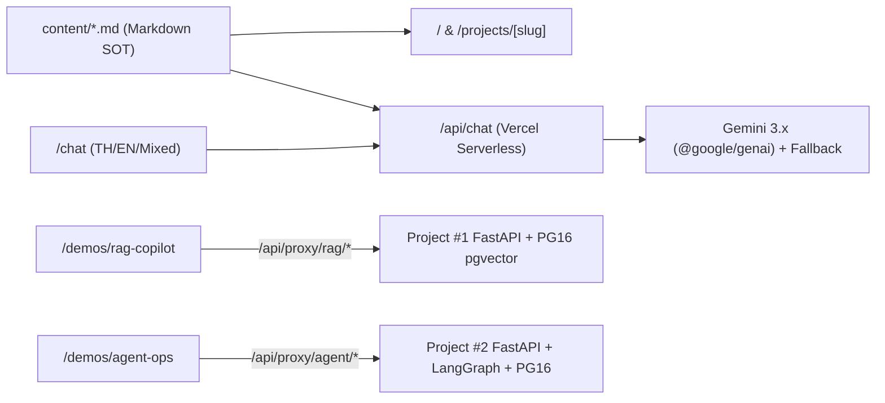

# Apec Sinlapachai — Unified AI & AI Automation Engineer Portfolio Hub

> **One unified Next.js 15 web hub** showcasing production AI engineering proof: live interactive demos for **Enterprise RAG Ops Copilot** (`/demos/rag-copilot`) and **Production AI Agent Ops** (`/demos/agent-ops`), extensible Markdown case studies (`/projects/[slug]`), and a **Zero-Cold-Start AI Portfolio Copilot** (`/chat`).

## Architecture



## Key Engineering Highlights
- **6-Layer AI-Native SSOT:** `AGENTS.md`, `docs/SPEC.md`, `docs/PROGRESS.md`, `docs/adr/0001..0003`, executable Zod schemas, ESLint/Vitest CI, and `/llms.txt`.
- **1-File Extensibility:** Drop a new Markdown file into `content/projects/<slug>.md` to automatically add a card on `/`, generate `/projects/<slug>`, and index it into the `/chat` AI Copilot.
- **Zero-Cold-Start AI Copilot (`/chat`):** Supports Thai, English, and Code-Mixed queries with 3-stage `$0` guardrails (prompt-injection block + lexical/token relevance gate + citation grounding), IP rate limiting, Tiered Gemini 3.x routing, and deterministic grounded fallback.
- **Same-Origin Demo Proxies:** `/demos/rag-copilot` and `/demos/agent-ops` route through Next.js `rewrites()` (`/api/proxy/rag/*` and `/api/proxy/agent/*`) so zero browser requests hit `*.onrender.com` directly.

## Quickstart

```bash
npm install
cp .env.example .env.local
# Optional: set GEMINI_API_KEY in .env.local (works offline via deterministic fallback if unset)
npm run dev
```

## Verification

```bash
npm run verify
# Runs: eslint . && tsc --noEmit && vitest run && next build
```

## Adding a Future Project (1 Step)
1. Copy `content/projects/_TEMPLATE_project.md` to `content/projects/<your-slug>.md`.
2. Fill in the YAML frontmatter and architectural sections.
3. Run `npm test && npm run build` — Zod validates the schema, the homepage/case-study routes update automatically, and `/chat` immediately knows about the new project.
