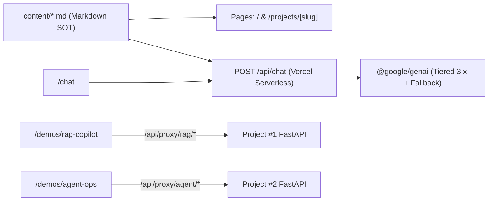

# SPEC — Unified AI & AI Automation Engineer Portfolio Hub (`apec-ai-portfolio`)

- **Status:** Approved
- **Owner:** Apec Sinlapachai
- **Last Updated:** 2026-11-26

---

## 1. Problem & Goal
- **Problem:** Flagship demos (`enterprise-rag-ops-copilot` and `production-ai-agent-ops`) live on separate URLs, forcing recruiters and hiring managers to switch tabs and read static READMEs to compare architecture, eval metrics, and trade-offs.
- **Goal:** Provide a **single unified URL** where a recruiter or technical lead can understand Apec's AI engineering proof in **15 seconds**, test both live production systems natively under one cohesive UI, and ask a **Zero-Cold-Start AI Portfolio Copilot (`/chat`)** deep questions across all current and future projects.

---

## 2. Scope Guardrails (Anti-Scope Creep)
### In-Scope (Must Build)
- [x] 6-Layer AI-Native SSOT repo layout (`AGENTS.md`, `CLAUDE.md`, `docs/SPEC.md`, `docs/PROGRESS.md`, `docs/adr/`, `.env.example`, CI, `/llms.txt`).
- [x] File-driven Markdown SOT (`content/profile.md`, `content/projects/*.md`, `content/til/*.md`) validated by Zod, powering both UI and `/api/chat`.
- [x] Recruiter 15-Second Landing Page (`/`) with Dark Engineering default + Light/Dark toggle.
- [x] Dynamic Project Case Study pages (`/projects/[slug]`) auto-generated from `content/projects/*.md`.
- [x] Zero-Cold-Start `/chat` + `POST /api/chat` with Thai/EN/Code-Mixed support, 3-stage `$0` guardrails, clickable citations, IP rate limiting, Tiered Gemini 3.x routing, and deterministic grounded fallback.
- [x] Contextual `"Ask AI about this project ->"` deep-links (`/chat?scope=...&q=...`) on cards and demo headers.
- [x] Native ports of Project #1 (`/demos/rag-copilot`) and Project #2 (`/demos/agent-ops`) via Same-Origin Next.js proxies (`/api/proxy/rag/*` and `/api/proxy/agent/*`).

### Out-of-Scope (Explicitly Not Building Now)
- Merging Python FastAPI backends of Project #1 and #2 into a monorepo (their standalone GitHub repos and CI remain clean and independent).
- Floating chat bubble widgets over demo workspaces.
- Authentication / user login or database persistence for portfolio visitors.
- Dedicated AI Agency services storefront page (`/services` deferred to v2).

---

## 3. Architecture & Data Flow

---

## 4. Acceptance Criteria (Definition of Done)
1. **Given** a recruiter opens `/`, **when** the page renders, **then** all featured projects, verified metrics, and `"Ask AI"` links load from `content/projects/*.md` with Dark Engineering theme and working Light/Dark toggle.
2. **Given** a user submits a Thai, English, or Code-Mixed question to `/chat`, **when** `POST /api/chat` runs, **then** it returns a grounded response with clickable citations in `< 3s` (Zero Cold-Start) or falls back deterministically if `GEMINI_API_KEY` is absent or rate-limited (`429`).
3. **Given** a prompt injection or out-of-scope personal query, **when** sent to `/api/chat`, **then** Stage 0/1 guardrails block/refuse at `$0` LLM cost with `refused: true`.
4. **Given** a user opens `/demos/rag-copilot` or `/demos/agent-ops`, **when** interacting with the live backend, **then** `0` browser network requests go directly to `*.onrender.com` (all routed via `/api/proxy/*`).
5. **Given** `npm run verify` runs locally or in GitHub Actions CI, **then** ESLint, `tsc --noEmit`, Vitest, and `next build` all exit `0`.

---

## 5. Non-Functional Requirements & Guardrails
- **Cost / Quota Cap:** `$0/mo` on Vercel Hobby; IP rate limiting (`15 req/min`, `60 req/day`) + deterministic fallback on `429`.
- **Latency:** `/api/chat` p95 `< 3s` (no Render cold-start).
- **Security & PDPA:** Zero personal PII in `content/`; `GEMINI_API_KEY` never sent to client; strict security headers in `next.config.ts`.
